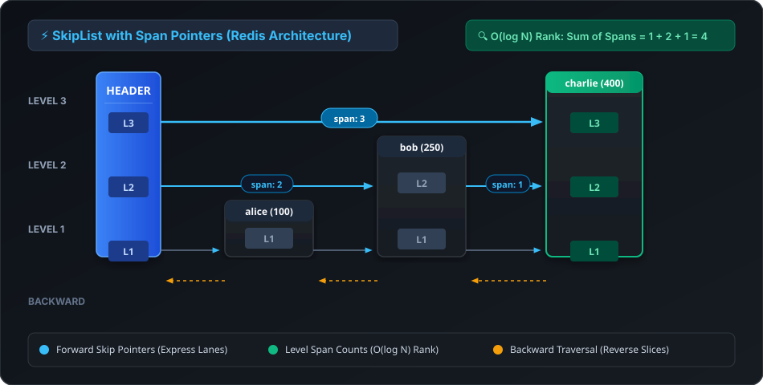
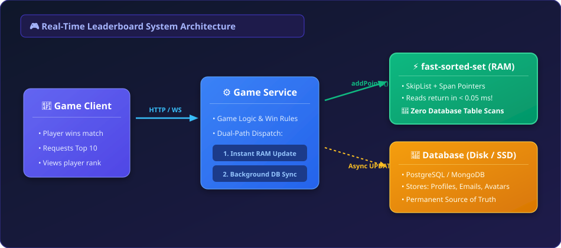

# fast-sorted-set ⚡

<div align="center">

[](https://www.npmjs.com/package/fast-sorted-set)
[](LICENSE)
[](https://www.typescriptlang.org/)
[](#)
[](#)
[](#)

<p align="center">
  <strong>Production-grade, zero-dependency in-memory Sorted Set & Real-Time Leaderboard engine for Node.js, TypeScript, and Edge runtimes.</strong>
  <br />
  <em>Powered by a Redis-style SkipList with Span pointers for O(log N) rank calculation and sub-millisecond range queries.</em>
</p>

</div>

---

<p align="center">
  
</p>

---

## 🌟 Why fast-sorted-set?

In modern web applications, gaming servers, and distributed systems, developers routinely need to maintain:
- **Live Leaderboards & Rankings** (e.g. Top 10 players, finding player rank among millions)
- **Priority Queues & Task Schedulers** (e.g. processing delayed jobs by timestamp score)
- **Sliding-Window Metrics & Rate Limiters** (e.g. tracking requests in a moving time window)

### The Problem with Traditional Approaches:
1. **Plain Arrays / Objects:** Calling `array.sort()` after every update costs $O(N \log N)$. With 50,000+ items, the event loop blocks and the process stutters.
2. **Relational Databases (PostgreSQL / MySQL):** Running `ORDER BY score DESC LIMIT 10` or counting ranks via `COUNT(*) WHERE score > my_score` executes expensive disk table scans that crush database CPU under high QPS.
3. **Dedicated Redis Clusters:** Redis `ZSET` is the industry benchmark, but provisioning, paying for, and maintaining a dedicated Redis cluster for local testing, CI/CD pipelines, Edge functions (Cloudflare Workers, Next.js Edge), or embedded desktop apps is complex and expensive.

### The Solution:
**`fast-sorted-set` brings the complete algorithmic power of Redis's `t_zset.c` directly into pure TypeScript with zero external dependencies.**

---

## 🔬 Algorithm Deep Dive: The Mathematics & Engineering

`fast-sorted-set` is built upon a hybrid combination of **William Pugh's SkipList (1990)** and **Salvatore Sanfilippo's (antirez) Redis Span Pointers**:

### 1. The Span Pointer Innovation ($O(\log N)$ Rank)
Standard textbook SkipLists only maintain forward pointers. To compute the rank of an element, you would have to start from the `head` and traverse node-by-node, taking **$O(N)$** time. 

In `fast-sorted-set`, each forward pointer at level $i$ maintains an integer **`span`**:
> **`span` represents the exact number of bottom-level (Level 1) nodes skipped over by that pointer.**

When searching for a node or finding its rank:
$$\text{Rank}(X) = \sum_{i \in \text{search path}} \text{span}[i]$$

By accumulating spans during the top-down traversal, rank calculation executes in **$O(\log N)$** time instead of $O(N)$!

### 2. Probabilistic Balancing (Geometric Distribution)
Instead of costly tree rotations (like AVL or Red-Black trees), SkipLists use randomized level promotion:
- Every node is assigned at least Level 1.
- Each level has a probability $P = 0.25$ ($1/4$ chance) to generate an additional level, up to a maximum of **32 levels** (supporting over $2^{32} \approx 4.29$ billion elements).
- **Memory Efficiency:** The expected number of pointers per node is $\frac{1}{1 - P} = 1.33$. This keeps the memory overhead minimal and cache-friendly.

### 3. Dual-Index Hybrid Architecture
`fast-sorted-set` maintains two data structures in lockstep:
- **Hash Map (`Map<T, number>`):** Delivers instantaneous **$O(1)$** lookup for `score(member)` and `has(member)`.
- **SkipList with Backward Pointers:** Provides **$O(\log N)$** ordered lookups, rank queries, and bidirectional range traversals.

### 4. Why SkipLists Beat Balanced Trees (Red-Black / AVL)
| Criterion | Balanced Trees (Red-Black / AVL) | SkipList with Span |
| :--- | :---: | :---: |
| **Re-balancing Mechanism** | Complex Tree Rotations & Color Flipping | Simple Pointer Adjustment |
| **Rank Calculation Support** | Requires Subtree Size Maintenance (hard across rotations) | **Native via Span Pointers** |
| **Bidirectional Traversal** | Complex In-order Iterators | **Doubly-Linked Bottom Layer** |
| **Implementation Complexity**| Very High & Bug-Prone | **Clean, Elegant & Robust** |

---

## 🏎️ Performance Benchmarks

*Benchmarked on Node.js v24.19.0 running on a standard workstation:*

| Operation | Scale | Total Time | Throughput | Complexity |
| :--- | :---: | :---: | :---: | :---: |
| **Insertions (`add`)** | 50,000 items | **726 ms** | **~68,700 ops/sec** | $O(\log N)$ |
| **Rank Lookups (`rank`)** | 10,000 lookups | **133 ms** | **~75,000 ops/sec** | $O(\log N)$ |
| **Top-10 Queries (`range`)** | 10,000 queries | **35 ms** | **~285,000 ops/sec** | $O(\log N + K)$ |
| **Score Increments (`incrBy`)** | 10,000 updates | **141 ms** | **~71,000 ops/sec** | $O(\log N)$ |

---

## 📊 Feature Comparison

| Feature | Plain Array | MongoDB / SQL | Redis ZSET | `fast-sorted-set` |
| :--- | :---: | :---: | :---: | :---: |
| **Insert / Update Time** | $O(N)$ | $O(\log N)$ (Disk I/O) | $O(\log N)$ | **$O(\log N)$ (In-Memory)** |
| **Get Rank of Member** | $O(N \log N)$ | $O(N)$ (Table scan) | $O(\log N)$ | **$O(\log N)$** |
| **Top K Query** | $O(N \log N)$ | High latency | $O(\log N + K)$ | **$O(\log N + K)$** |
| **External Setup** | None | High | Medium/High ($20+/mo) | **Zero (0 dependencies)** |
| **Works on Edge/Workers** | Yes | Network calls | Network latency | **Yes (Direct in RAM)** |

---

## 🚀 Installation

```bash
# npm
npm install fast-sorted-set

# pnpm
pnpm add fast-sorted-set

# yarn
yarn add fast-sorted-set
```

---

## 📖 Quick Start

### ⚡ 3-Second Quickstart (For Complete Beginners)

Don't want to deal with complex classes or options? Use the ultra-simple factory:

```javascript
import { createLeaderboard } from 'fast-sorted-set';

const board = createLeaderboard();

// 1. Add players and scores
board.set('Rakib', 1200);
board.set('Ayesha', 1500);
board.set('Tanvir', 800);

// 2. Get someone's rank (1 = 1st place)
console.log(board.rank('Rakib')); // 2

// 3. Add points when someone wins
board.increment('Rakib', 500); // Rakib is now #1!
console.log(board.rank('Rakib')); // 1

// 4. Get the Top 10 Leaderboard
console.log(board.top(10));
```

---

### 1. General In-Memory Sorted Set (`FastSortedSet`)

`FastSortedSet` is a low-level, high-performance data structure identical to Redis `ZSET`:

```typescript
import { FastSortedSet } from 'fast-sorted-set';

const set = new FastSortedSet<string>();

// 1. Add members with scores - O(log N)
set.add('alice', 1500);
set.add('bob', 2200);
set.add('charlie', 1800);

// 2. O(1) Score lookups
console.log(set.score('bob')); // 2200
console.log(set.has('alice')); // true

// 3. Increment score atomically - O(log N)
set.incrBy('alice', 800); // 1500 + 800 = 2300 (Alice takes #1 spot!)

// 4. Get Rank - O(log N) (Default reverse: true, highest score = rank 1)
console.log(set.rank('alice')); // 1
console.log(set.rank('bob'));   // 2

// 5. Slice Top K Members
const top2 = set.range(0, 1, { reverse: true });
console.log(top2); // ['alice', 'bob']

// 6. Range query by score
const midTier = set.rangeByScore(1500, 2000);
console.log(midTier); // [{ member: 'charlie', score: 1800 }]
```

---

### 2. High-Level Gaming Leaderboard (`Leaderboard`)

`Leaderboard` is a specialized, ready-to-use class designed for real-time multiplayer games, tournaments, and contests (directly implements **Alex Xu Chapter 25: Real-time Gaming Leaderboard**):

```typescript
import { Leaderboard } from 'fast-sorted-set';

// Generic support for string or number IDs
const tournament = new Leaderboard<string>();

// Record initial scores
tournament.recordScore('player_rakib', 1250);
tournament.recordScore('player_ayesha', 1650);
tournament.recordScore('player_nayeem', 1420);
tournament.recordScore('player_tanvir', 980);
tournament.recordScore('player_sakib', 1100);

// Player wins a match and earns points
tournament.addPoints('player_rakib', 500); // 1250 + 500 = 1750

// 1. Instant 1-based rank lookup
console.log(tournament.getRank('player_rakib')); // 1

// 2. Fetch Top 3 players with ranks and scores
const top3 = tournament.getTop(3);
console.table(top3);
/*
┌─────────┬──────┬─────────────────┬───────┐
│ (index) │ rank │ member          │ score │
├─────────┼──────┼─────────────────┼───────┤
│ 0       │ 1    │ 'player_rakib'  │ 1750  │
│ 1       │ 2    │ 'player_ayesha' │ 1650  │
│ 2       │ 3    │ 'player_nayeem' │ 1420  │
└─────────┴──────┴─────────────────┴───────┘
*/

// 3. "Around User" Context (Chapter 25 Bonus Requirement)
// Display 2 players above and 2 players below 'player_nayeem'
const context = tournament.getAroundUser('player_nayeem', { above: 1, below: 1 });
console.table(context);
```

---

## 💡 Real-World Design Pattern: Syncing with Database

A common system design question is: *"How does this work when all user data is already in PostgreSQL or MongoDB?"*

- **Disk (PostgreSQL/MongoDB):** Acts as the permanent **Source of Truth** for profiles, emails, passwords, and persisted score logs.
- **RAM (`fast-sorted-set`):** Acts as the **Live Ranking Engine**. Ranks are queried from RAM in microseconds without touching the database disk.

<p align="center">
  
</p>

```typescript
import { Leaderboard } from 'fast-sorted-set';

class ProductionGameService {
  private leaderboard = new Leaderboard<string>();

  // 1. Warm up leaderboard cache on server start
  async onServerStart(database: any) {
    const players = await database.query('SELECT user_id, total_score FROM users');
    for (const p of players) {
      this.leaderboard.recordScore(p.user_id, p.total_score);
    }
  }

  // 2. When player wins a match
  async onPlayerWin(userId: string, pointsWon: number, database: any) {
    // A. Update DB for persistence
    await database.query('UPDATE users SET total_score = total_score + $1 WHERE user_id = $2', [pointsWon, userId]);

    // B. Instant RAM update
    this.leaderboard.addPoints(userId, pointsWon);
  }

  // 3. When player views the leaderboard
  async getLeaderboard(database: any) {
    // Zero database table scans! Ranks come instantly from memory:
    const top = this.leaderboard.getTop(10);
    
    // Enrich only the top 10 profiles with avatar/name
    return Promise.all(top.map(async entry => ({
      ...entry,
      profile: await database.getUserProfile(entry.member)
    })));
  }
}
```

---

## 📚 API Reference

### `FastSortedSet<T>`

| Method | Return | Complexity | Description |
| :--- | :--- | :---: | :--- |
| `add(member: T, score: number)` | `boolean` | $O(\log N)$ | Inserts or updates member. Returns `true` if new member. |
| `addMany(items: Array<{ member, score }>)` | `number` | $O(M \log N)$ | Batch adds multiple items. Returns added count. |
| `score(member: T)` | `number \| undefined` | $O(1)$ | Returns the current score of member. |
| `has(member: T)` | `boolean` | $O(1)$ | Checks if member exists. |
| `rank(member: T, options?)` | `number \| null` | $O(\log N)$ | Returns rank. `reverse: true` means 1 is highest score. |
| `incrBy(member: T, delta: number)` | `number` | $O(\log N)$ | Increments score and updates rank position atomically. |
| `remove(member: T)` | `boolean` | $O(\log N)$ | Deletes a member. Returns `true` if removed. |
| `range(start, stop, options?)` | `T[]` | $O(\log N + M)$ | Slices members by rank index (supports negative index). |
| `rangeWithScores(start, stop, options?)`| `ISortedSetItem<T>[]` | $O(\log N + M)$ | Slices members with their scores. |
| `rangeByScore(min, max, options?)` | `ISortedSetItem<T>[]` | $O(\log N + M)$ | Returns items matching score interval. |
| `count(min, max)` | `number` | $O(\log N)$ | Counts items within score interval. |
| `card()` / `size` | `number` | $O(1)$ | Total number of elements. |
| `clear()` | `void` | $O(1)$ | Clears all elements. |

---

### `Leaderboard<T>`

| Method | Return | Description |
| :--- | :--- | :--- |
| `recordScore(player: T, score: number)` | `void` | Sets or updates a player's absolute score. |
| `addPoints(player: T, points: number)` | `number` | Increments points and returns new score. |
| `getRank(player: T)` | `number \| null` | 1-based rank (1 = #1 Top Player). |
| `getScore(player: T)` | `number \| undefined` | Gets player's score. |
| `getTop(count?: number)` | `LeaderboardEntry<T>[]` | Retrieves the top $K$ players. |
| `getAroundUser(player: T, options?)` | `LeaderboardEntry<T>[]` | Retrieves slice of players above & below target player. |
| `totalPlayers` | `number` | Total registered players. |
| `reset()` | `void` | Resets the entire leaderboard. |

---

## 🛠️ Development & Testing

```bash
# Clone repository
git clone https://github.com/iamrakiburrahman/fast-sorted-set.git
cd fast-sorted-set

# Install dependencies
npm install

# Run unit tests
npm test

# Run high-throughput 50,000 item benchmark
npm run test:benchmark

# Build dual ESM + CJS bundle
npm run build
```

---

## 📄 License

MIT License © [Rakibur Rahman](https://github.com/iamrakiburrahman)
